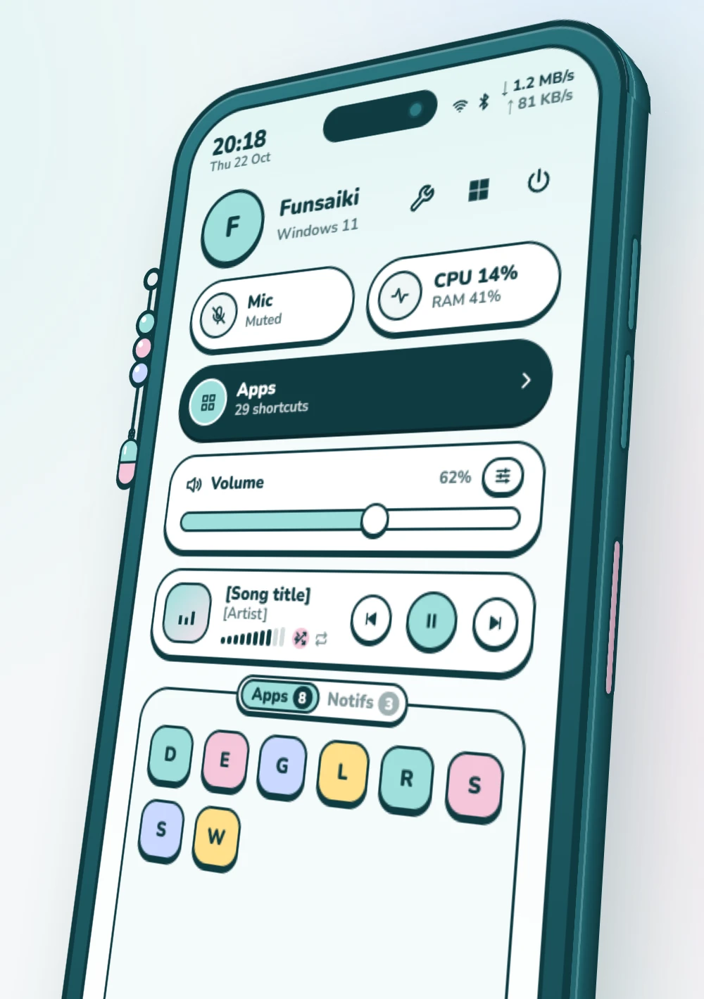
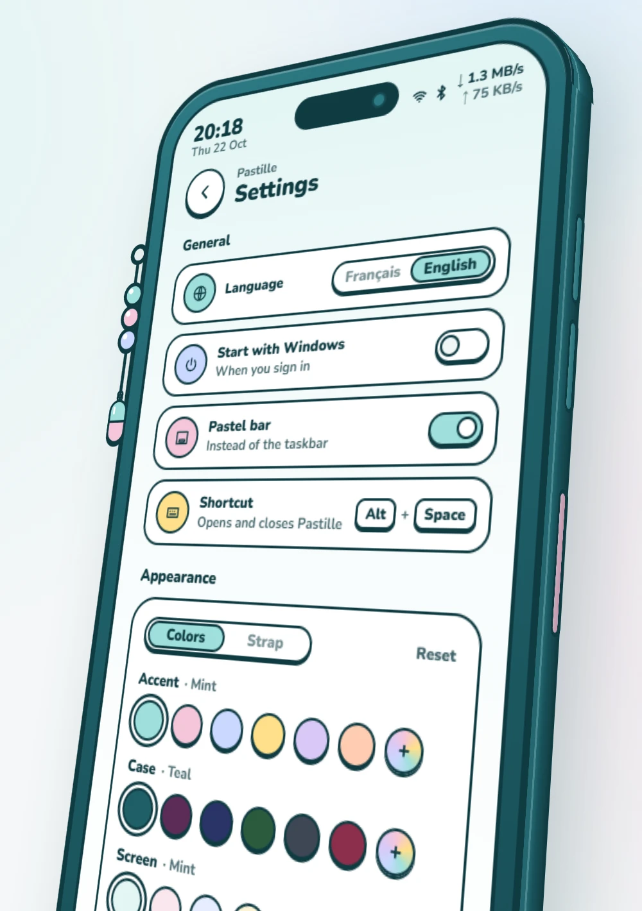
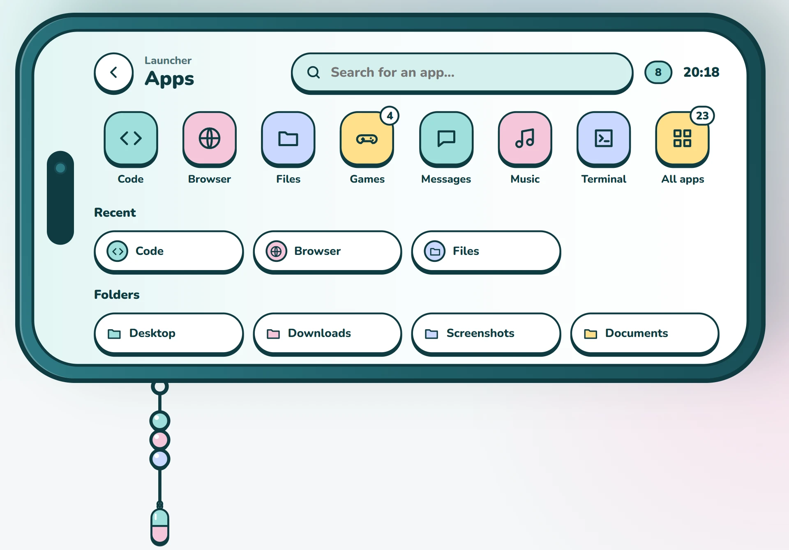
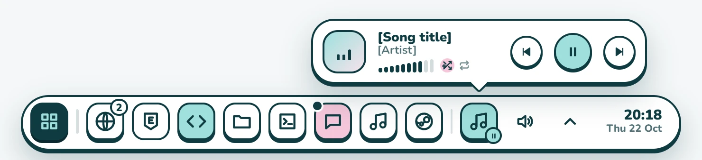

# Pastille

An app launcher for Windows 11, shaped like a pastel phone. **Alt+Space** slides the phone up from the bottom of the screen with quick settings; the Applications button lays it flat to show your apps. Optionally, the **pastel bar** replaces the Windows taskbar.

The design is inspired by a [Project Sekai inspired Hyprland setup](https://www.reddit.com/r/unixporn/comments/1x37y28/hyprland_project_sekai_inspired_quickshell/) shared on r/unixporn by [u/Single-Flamingo-8194](https://www.reddit.com/user/Single-Flamingo-8194/), who kindly gave me permission to use their idea. Thank you so much!

<p align="center">
  
  
</p>
<p align="center">
  
</p>
<p align="center">
  
</p>

> The interface is in English and French: Pastille starts in the language of Windows, and the settings page switches between the two.

## Features

**The phone (quick settings)**
- Volume, microphone, per-app volume mixer, CPU and memory usage, network speed.
- Spotify now playing: title, cover art, controls and, once Spotify is connected, its own volume, shuffle and repeat.
- Shortcuts to Wi-Fi, Bluetooth, Windows Settings and a power menu (with confirmation).
- A **Settings** page, behind the wrench next to your name: language, start with Windows, the pastel bar, customization, Spotify connection, `apps.json`, updates.
- **Apps** tab: apps running in the background (notification area). **Notifs** tab: recent downloads, Steam updates, restart required by Windows Update, low disk space.

**Apps**
- Your own tiles and folders, described in `apps.json`, with groups.
- Added automatically: Steam and Epic games, Start menu apps, your Spotify playlists.
- Search: apps, calculations, Windows Settings pages, open windows, and a web search when nothing matches.
- Recents, switching to an already open window, and a right-click menu to run as administrator, open the file location, pin to the bar or hide a Start menu app.

**The pastel bar (optional)**
- A pill at the bottom of each screen, which slides out when the mouse touches the edge.
- Open windows with hover previews, pinned apps and alerts.
- The notification area, whose icons respond just like in the Windows taskbar (right-click included).
- Sound, a calendar and a Spotify player.

**Customize** (in the settings page)
- Accent, case, screen and ink colors, from a palette or any custom color.
- The strap charm (or your own image) and the bead colors. The pastel bar uses the same accent and ink.
- The phone's tilt, from face-on to the original angle, its size and its place on the screen (left, center or right).

## Installation

1. Download `Pastille_x.y.z_x64-setup.exe` from the [latest release](https://github.com/Funsaiki/pastille/releases/latest) and run it: it installs for your account only, without administrator rights.
2. The installer is not signed, so Windows shows "Windows protected your PC". Click "More info", then "Run anyway".
3. Pastille opens by itself the first time. After that, **Alt+Space** opens and closes it; Escape or a click outside the phone closes it too.

Updates: from version 1.11.0, Pastille checks the releases by itself and shows new versions in its **Notifs** tab; one click downloads, verifies and installs the update, then Pastille restarts. Earlier versions are updated by running the new installer, after quitting Pastille. Your config, Spotify connection and customization are kept.

Settings are in the phone: click the wrench next to your name. The menu of Pastille's icon, next to the clock, has **Show**, **Settings** and **Quit**; when the pastel bar is on, open this menu by right-clicking the Apps tile of the pill.

Pastille is made for Windows 11; it hasn't been tried on Windows 10.

## Configuration

The config lives in `%APPDATA%\dev.lanceur.pastel\apps.json`, created on first launch from [`apps.example.en.json`](apps.example.en.json) (or [`apps.example.json`](apps.example.json), its French version):

```jsonc
{
  "accent": "#9fe0dc",
  "shortcut": "Alt+Space",
  "apps": [
    // a Start menu app, by name
    { "label": "Code", "icon": "code", "app": "Visual Studio Code" },
    // the default program for a protocol or file extension
    { "label": "Browser", "icon": "browser", "default": "https" },
    // a path, with arguments if needed
    { "label": "Terminal", "icon": "terminal", "target": "wt.exe" },
    // a group; "auto" fills it with Steam games ("steam"), Epic games ("epic"),
    // Spotify playlists ("spotify") or Start menu apps ("start")
    { "label": "Games", "icon": "games", "children": [
      { "label": "Steam", "icon": "steam", "auto": "steam", "children": [
        { "label": "Steam", "icon": "steam", "app": "Steam" }
      ] }
    ] }
  ],
  "favorites": [
    { "label": "Downloads", "target": "shell:Downloads" }
  ]
}
```

- An `app` or `default` tile that can't be found on the PC is not shown, so the same config works on several PCs.
- `icon`: `code`, `browser`, `files`, `games`, `messages`, `music`, `terminal`, `settings`, `library`, `shield`, `star`, `sword`, `car`, `cards`, `cube`, `trophy`, `document`, `applications`, `steam`, `epic`, `lol`, `valorant`, `starrail`, `zzz`, `wuwa`, `nte` or `endfield`. An `app` tile without one shows the app's own icon.
- `keywords` adds extra words for the search.
- "Edit apps.json" in the settings page opens it; Pastille reloads it the next time it opens, or right away with "Reload the config".

### Spotify (optional)

Without connecting, Pastille already shows and controls what's playing. Connecting adds Spotify's own volume, shuffle, repeat and your playlists. It requires a **Premium** account, and everyone creates their own (free) Spotify app to get a Client ID. "Connect" in the Spotify section of the settings page opens a page that walks you through it.

### Pastel bar

Turn on "Pastel bar" in the settings page: the Windows taskbar is hidden and a pill appears at the bottom of each screen. Turn it off or quit Pastille to get the taskbar back; if Pastille stops unexpectedly, a small watchdog process brings it back.

## Development

Requirements: Windows, [Node.js](https://nodejs.org/) 24, Rust (stable) and the [Tauri 2 prerequisites](https://v2.tauri.app/start/prerequisites/).

```powershell
npm install
npm run tauri dev     # the app, rebuilt on every change
npm run tauri build   # the installer, in src-tauri/target/release/bundle/nsis/ (signed for
                      # updates: needs the TAURI_SIGNING_PRIVATE_KEY environment variable)
npm run dev           # browser preview with sample data:
                      # http://localhost:1420/ (phone) and http://localhost:1420/bar.html (bar)
```

The development build shares its config and shortcut with the installed version: quit Pastille before `npm run tauri dev`.

- `src/`: the interface, in TypeScript, without a framework.
- `src-tauri/`: Rust (Tauri 2 and the Windows API).
- `mockup/`: the reference mockup of the phone.
- `CLAUDE.md`: the project brief, developed with [Claude Code](https://claude.com/claude-code).

Pushing a `vX.Y.Z` tag matching the version in `src-tauri/tauri.conf.json` runs the "Release" workflow, which builds and publishes the release (installer, signature and the `latest.json` read by installed copies).

## Credits

- Design inspired by [u/Single-Flamingo-8194's post](https://www.reddit.com/r/unixporn/comments/1x37y28/hyprland_project_sekai_inspired_quickshell/) on r/unixporn, with their permission.
- [Nunito](https://fonts.google.com/specimen/Nunito) font (SIL Open Font License).
- Built with [Tauri](https://tauri.app/).

## License

© 2026 Funsaiki. All rights reserved. The source code is public to read, but it is not licensed for reuse. You're welcome to install and use Pastille from the [releases](https://github.com/Funsaiki/pastille/releases/latest).
