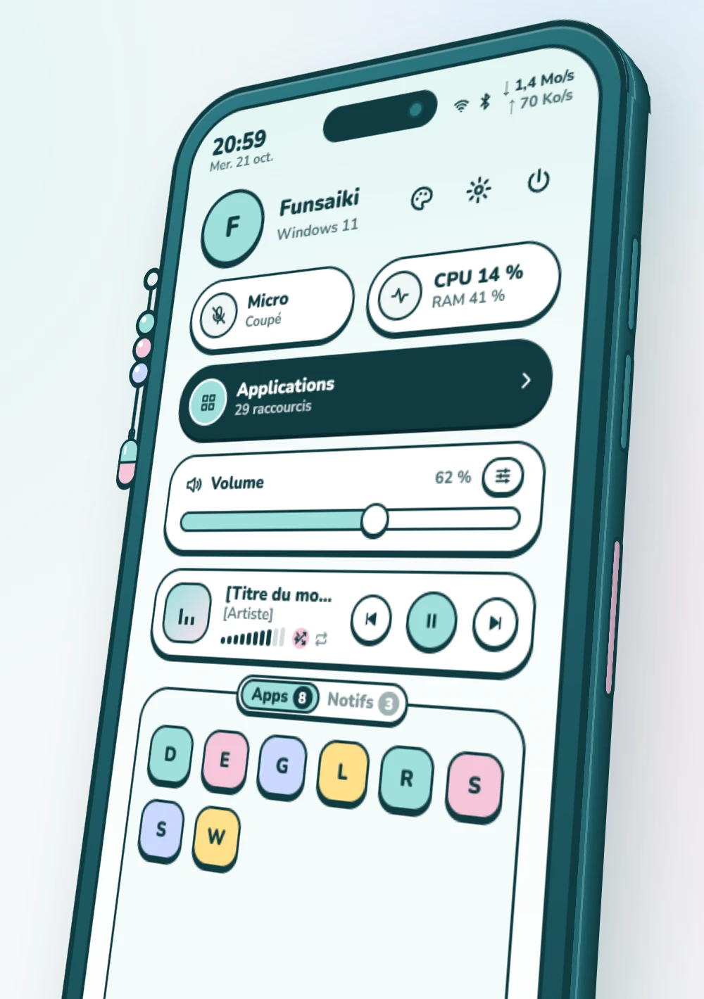
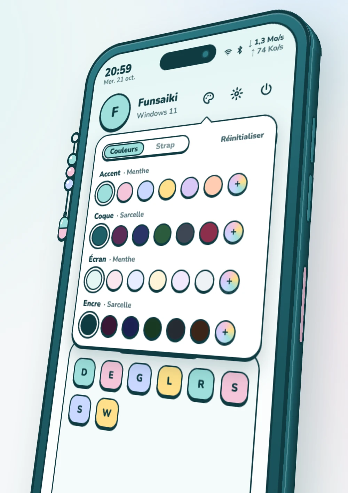
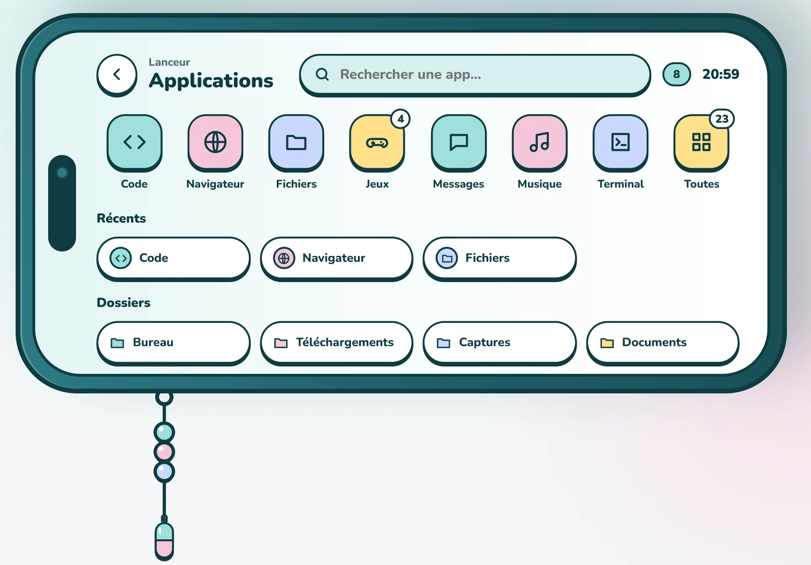
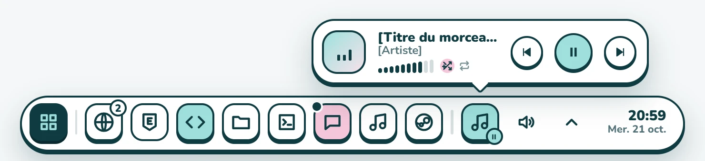

# Pastille

Un lanceur d'applications pour Windows 11 en forme de téléphone pastel. **Alt+Espace** fait monter le téléphone du bas de l'écran, avec des réglages rapides ; le bouton Applications le couche pour afficher vos applications. En option, la **barre pastel** remplace la barre des tâches de Windows.

Le design s'inspire d'un [setup Hyprland inspiré de Project Sekai](https://www.reddit.com/r/unixporn/comments/1x37y28/hyprland_project_sekai_inspired_quickshell/), partagé sur r/unixporn par [u/Single-Flamingo-8194](https://www.reddit.com/user/Single-Flamingo-8194/), qui m'a autorisé à reprendre son idée. Merci beaucoup !

<p align="center">
  
  
</p>
<p align="center">
  
</p>
<p align="center">
  
</p>

## Fonctionnalités

**Le téléphone (réglages rapides)**
- Volume, micro, mélangeur par application, processeur et mémoire, débit réseau.
- Lecture en cours de Spotify : titre, pochette, commandes, et, une fois Spotify connecté, son volume, l'aléatoire et la répétition.
- Raccourcis vers le Wi-Fi, le Bluetooth, les Paramètres et le menu d'alimentation (avec confirmation).
- Onglet **Apps** : les applications en arrière-plan (zone de notification). Onglet **Notifs** : téléchargements récents, mises à jour Steam, redémarrage demandé par Windows Update, disque presque plein.

**Les applications**
- Vos tuiles et vos dossiers, décrits dans `apps.json`, avec des groupes.
- Ajoutés tout seuls : les jeux Steam et Epic, les applications du menu Démarrer, vos playlists Spotify.
- Recherche : applications, calculs, pages des Paramètres de Windows, fenêtres ouvertes, et recherche sur le web si rien ne correspond.
- Récents, retour à la fenêtre déjà ouverte, clic droit pour exécuter en administrateur, ouvrir l'emplacement, épingler à la barre ou masquer une application du menu Démarrer.

**La barre pastel (optionnelle)**
- Une pilule en bas de chaque écran, qui sort quand la souris touche le bord.
- Les fenêtres ouvertes, avec aperçus au survol, applications épinglées et alertes.
- La zone de notification, dont les icônes répondent comme dans la barre de Windows (clic droit compris).
- Le son, un calendrier et un lecteur Spotify.

**Personnaliser**
- Couleurs de l'accent, de la coque, de l'écran et de l'encre, au nuancier ou en couleur libre.
- La breloque du strap (ou votre propre image) et la couleur des perles. La barre pastel reprend l'accent et l'encre.

## Installation

1. Téléchargez `Pastille_x.y.z_x64-setup.exe` depuis la [dernière release](https://github.com/Funsaiki/pastille/releases/latest) et lancez-le : l'installation se fait pour votre compte, sans droits administrateur.
2. L'installateur n'est pas signé : Windows affiche « Windows a protégé votre ordinateur ». Cliquez sur « Informations complémentaires », puis « Exécuter quand même ».
3. Pastille s'ouvre une première fois toute seule. Ensuite, **Alt+Espace** l'ouvre et la ferme ; Échap ou un clic à côté la referment.

Pour une mise à jour, quittez Pastille avant de lancer le nouvel installateur. La config, la connexion à Spotify et la personnalisation sont gardées.

Le menu de l'icône de Pastille, près de l'heure, propose : modifier ou recharger `apps.json`, connecter Spotify, activer la barre pastel, démarrer avec Windows, quitter. Quand la barre pastel est active, ce menu s'ouvre d'un clic droit sur la tuile Applications de la pilule.

L'interface est en français. Pastille est fait pour Windows 11 ; Windows 10 n'a pas été essayé.

## Configuration

La config est dans `%APPDATA%\dev.lanceur.pastel\apps.json`, créée au premier lancement à partir de [`apps.example.json`](apps.example.json) :

```jsonc
{
  "accent": "#9fe0dc",
  "shortcut": "Alt+Space",
  "apps": [
    // une application du menu Démarrer, par son nom
    { "label": "Code", "icon": "code", "app": "Visual Studio Code" },
    // le programme par défaut pour un protocole ou une extension
    { "label": "Navigateur", "icon": "navigateur", "default": "https" },
    // un chemin, avec des arguments si besoin
    { "label": "Terminal", "icon": "terminal", "target": "wt.exe" },
    // un groupe ; « auto » y ajoute les jeux Steam ("steam"), Epic ("epic"),
    // les playlists ("spotify") ou les applications du menu Démarrer ("start")
    { "label": "Jeux", "icon": "jeux", "children": [
      { "label": "Steam", "icon": "steam", "auto": "steam", "children": [
        { "label": "Steam", "icon": "steam", "app": "Steam" }
      ] }
    ] }
  ],
  "favorites": [
    { "label": "Téléchargements", "target": "shell:Downloads" }
  ]
}
```

- Une tuile `app` ou `default` introuvable sur le PC n'est pas affichée : la même config sert sur plusieurs PC.
- `keywords` ajoute des mots pour la recherche.
- Après une modification, choisissez « Recharger la config » dans le menu de l'icône.

### Spotify (optionnel)

Sans connexion, Pastille affiche déjà le morceau en cours et le pilote. La connexion ajoute le volume de Spotify, l'aléatoire, la répétition et les playlists. Elle demande un compte **Premium**, et chacun crée sa propre app Spotify, gratuite, pour obtenir un Client ID. « Connecter Spotify… » dans le menu de l'icône ouvre une page qui guide pas à pas.

### Barre pastel

Cochez « Barre pastel » dans le menu de l'icône : la barre des tâches de Windows est masquée et une pilule apparaît en bas de chaque écran. Décochez la case ou quittez Pastille pour la retrouver ; si Pastille s'arrête brutalement, un petit processus de garde la réaffiche.

## Développement

Prérequis : Windows, [Node.js](https://nodejs.org/) 24, Rust (stable) et les [prérequis de Tauri 2](https://v2.tauri.app/start/prerequisites/).

```powershell
npm install
npm run tauri dev     # l'application, recompilée à chaque changement
npm run tauri build   # l'installateur, dans src-tauri/target/release/bundle/nsis/
npm run dev           # aperçu navigateur avec des données d'exemple :
                      # http://localhost:1420/ (téléphone) et http://localhost:1420/barre.html (barre)
```

La version de développement partage la config et le raccourci de la version installée : quittez Pastille avant `npm run tauri dev`.

- `src/` : l'interface, en TypeScript, sans framework.
- `src-tauri/` : Rust (Tauri 2 et l'API Windows).
- `maquette/` : la maquette de référence du téléphone.
- `CLAUDE.md` : le brief du projet, développé avec [Claude Code](https://claude.com/claude-code).

Un tag `vX.Y.Z`, égal à la version de `src-tauri/tauri.conf.json`, lance le workflow « Installateur », qui compile et publie la release.

## Crédits

- Design inspiré du [post de u/Single-Flamingo-8194](https://www.reddit.com/r/unixporn/comments/1x37y28/hyprland_project_sekai_inspired_quickshell/) sur r/unixporn, avec son autorisation.
- Police [Nunito](https://fonts.google.com/specimen/Nunito) (SIL Open Font License).
- Construit avec [Tauri](https://tauri.app/).
